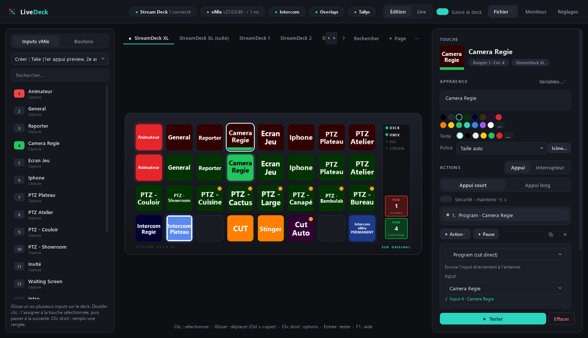
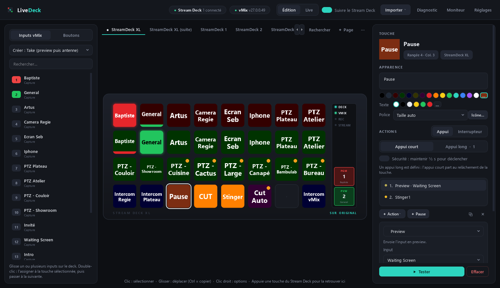
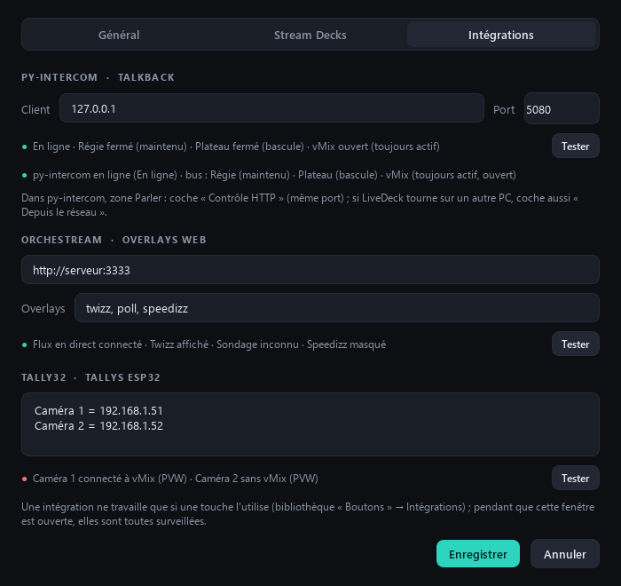
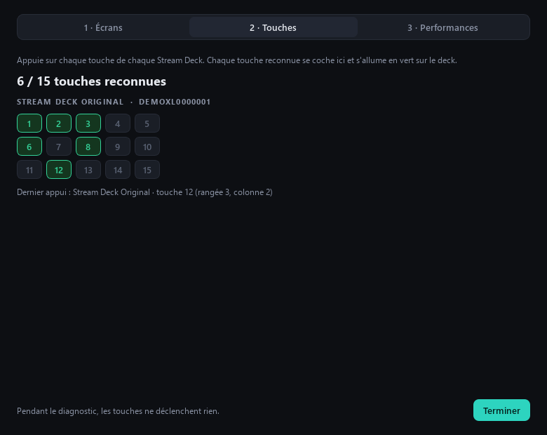
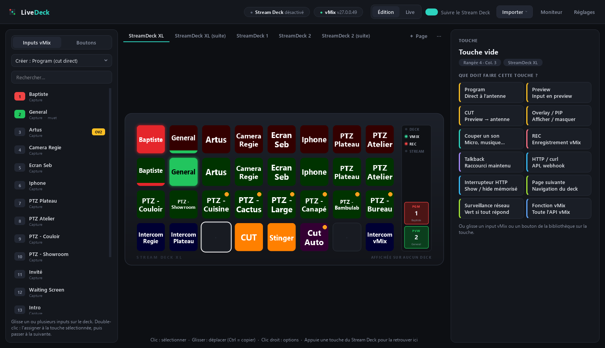

<div align="center">

# 🎛️ LiveDeck

**Pilote vMix avec tes Stream Decks, simplement.**

Une alternative légère à Bitfocus Companion : une seule fenêtre, ton Stream Deck à l'écran,
des touches qui se câblent en un double-clic et des retours d'état sans rien régler.




</div>

---

## Pourquoi LiveDeck ?

Avec Companion, une simple touche « Camera Régie à l'antenne » demandait une action, un feedback, des couleurs,
des variables `$(vmix:input_xxx_number)`… Avec LiveDeck :

1. **Tu sélectionnes** une touche (ou tu appuies dessus sur le Stream Deck : elle se sélectionne à l'écran).
2. **Tu double-cliques** un input vMix : la touche est créée, et la sélection passe à la suivante.
3. **C'est tout** : le retour d'état est déduit de l'action, et la sauvegarde est automatique.

Mieux encore : **glisse plusieurs inputs sur le deck** et toute une rangée est câblée d'un coup.

## Fonctionnalités

| | |
|---|---|
| 🎬 **Take** | Une touche au lieu de deux : 1er appui en preview (vert), 2e appui à l'antenne (rouge) avec la transition choisie, même en appuyant très vite. |
| 🚦 **Retours automatiques** | Rouge à l'antenne, vert en preview, jaune en overlay, rouge quand le son est coupé… sans rien configurer. |
| ⚡ **Réactif** | État vMix poussé en direct (TALLY / ACTS), seules les touches qui changent sont redessinées. La latence s'affiche dans l'en-tête. |
| ⏱️ **Appui long et sécurité** | Une deuxième action en appui long, ou une touche à maintenir ½ s pour FTB et l'arrêt du stream. |
| ⌨️ **Clavier et HTTP** | Raccourcis enregistrés en appuyant sur les touches (maintenus ou non), requêtes HTTP en collant une commande `curl`. |
| 📡 **OSC, TCP / UDP, API JSON** | Pilote QLab, Reaper, une X32, un projecteur ou une caméra VISCA, et affiche la valeur d'une API JSON sur une touche. |
| 🔤 **Texte dynamique** | Titre à l'antenne, temps restant d'une vidéo, texte d'un titre, heure… mis à jour en direct sur les touches. |
| 🎙️ **Intégrations maison** | Talkback **py-intercom**, overlays **orchestream** (v2 et v1) et **Tally32**, avec leur état en direct, un bouton Tester et des messages d'erreur clairs. |
| 🛟 **Sûr en direct** | Un talkback se coupe toujours au relâché, même si la touche change entre-temps ; tout est relâché au débranchement ou à la fermeture. Sauvegardes quotidiennes. |
| 🔒 **Mode Live** | L'édition se verrouille pendant le direct, seul ▶ Tester reste actif. |
| 🔎 **Recherche (Ctrl+F)** | Retrouve une touche sur toutes les pages ; la touche vide propose toutes les actions, avec recherche et catégories. |
| 🩺 **Diagnostic** | Vérifie en une minute les écrans, chaque touche et les performances de tes Stream Decks. |
| 🔌 **Plug & play** | Détection à chaud des Stream Decks, reconnexion automatique à vMix, inputs retrouvés par leur nom. |
| 📥 **Import Companion** | Ta config `.companionconfig` est convertie en un clic, variables et intégrations comprises. |
| 🖥️ **Discret** | Réduit près de l'horloge, démarrage automatique avec Windows, une seule instance. |

<table>
<tr>
<td width="50%"><p align="center"><sub>Étapes d'une touche, prochain appui</sub></p></td>
<td width="50%"><p align="center"><sub>Intégrations py-intercom, orchestream, Tally32</sub></p></td>
</tr>
<tr>
<td width="50%"><p align="center"><sub>Diagnostic des Stream Decks</sub></p></td>
<td width="50%"><p align="center"><sub>Toutes les actions, avec recherche</sub></p></td>
</tr>
</table>

## Démarrage rapide

### Option 1 · L'exe (recommandé)

1. Va dans **[Releases](https://github.com/lfpoulain/py-livedeck/releases/latest)** et télécharge `LiveDeck-x.y.z-win64.exe`.
2. Range-le dans un dossier à toi (par ex. `Documents\LiveDeck`) et double-clique dessus. Pas d'installation, pas de Python à installer.

Ta configuration est rangée dans **`%APPDATA%\LiveDeck`**, pas à côté de l'exe. Pour mettre à jour, quitte LiveDeck
(clic droit sur l'icône près de l'horloge → Quitter) et remplace l'exe par la nouvelle version : tu retrouves toutes tes pages.

> [!NOTE]
> L'exe n'est pas signé. Au premier lancement, Windows SmartScreen peut afficher « Windows a protégé votre ordinateur » :
> clique **Informations complémentaires → Exécuter quand même**.

### Option 2 · Depuis les sources

**Prérequis :** Windows 10/11 et [Python 3.10+](https://www.python.org/downloads/).

```bash
git clone https://github.com/lfpoulain/py-livedeck.git
```

Double-clique ensuite sur **`setup.bat`** (une seule fois : environnement Python, dépendances et `hidapi.dll`, la
bibliothèque USB des Stream Decks), puis sur **`LiveDeck.bat`**.

> [!IMPORTANT]
> **Ferme Companion et le logiciel Elgato Stream Deck avant de lancer LiveDeck** : un seul logiciel à la fois peut piloter un Stream Deck.

Au premier démarrage, clique **Fichier → Config Bitfocus Companion…** pour reprendre ta configuration.
Côté vMix, rien à configurer : LiveDeck utilise l'API TCP (port 8099), active par défaut.

## Documentation

| Guide | Contenu |
|---|---|
| 📘 [Guide d'utilisation](docs/guide.md) | Interface, création des touches, étapes, retours d'état, intégrations, diagnostic, raccourcis, dépannage |
| 🧱 [Architecture](docs/architecture.md) | Organisation du code et flux de données, pour faire évoluer l'app |
| 🚀 [Publier une version](docs/release.md) | Compiler l'exe et publier une release en une commande |
| 📝 [Journal des versions](CHANGELOG.md) | Historique des changements |

## Structure du projet

```
py-livedeck/
├── main.py                 # point d'entrée (sources, exe, démarrage automatique)
├── setup.bat / LiveDeck.bat
├── livedeck/
│   ├── engine.py           # moteur : Stream Decks ⇄ actions ⇄ vMix, annuler / rétablir
│   ├── vmix.py             # client API TCP vMix
│   ├── deck.py             # Stream Decks : détection à chaud, rendu, appuis
│   ├── actions.py          # catalogue des actions
│   ├── feedback.py         # retours d'état automatiques
│   ├── vars.py             # texte dynamique $(vmix:…)
│   ├── netsend.py          # TCP / UDP / OSC
│   ├── integrations.py     # py-intercom, orchestream, Tally32
│   ├── companion_import.py # import Bitfocus Companion
│   └── ui/                 # interface PySide6
├── tools/
│   ├── fake_vmix.py        # faux vMix pour tester sans vMix
│   ├── build_exe.py        # compilation de l'exe (PyInstaller)
│   └── release.py          # publication d'une version
├── .github/workflows/      # tests + release de l'exe à chaque version poussée sur main
├── tests/                  # tests de bout en bout (serveurs simulés)
└── docs/                   # documentation
```

## Développement

```bash
python tools/fake_vmix.py 8099
```

Ce script simule vMix sur le port 8099 (inputs, Mix 1 à 4, overlays, son, titres, vidéos, enregistrement ; un 2e
argument, ex. `0.08`, ajoute un délai de réponse) : tu peux
utiliser l'app sans vMix, en mode **Live**.

```bash
python tests/test_core.py
```

Ce script lance les tests de bout en bout : import Companion, vMix, Take, appui long, Stream Deck simulé,
édition, mode Live, recherche, diagnostic, relâché sûr, texte dynamique, OSC / TCP, py-intercom, orchestream et Tally32.
Ils fonctionnent aussi avec `pytest`.
À chaque push sur `main`, GitHub Actions les relance, et publie l'exe quand la version change.
