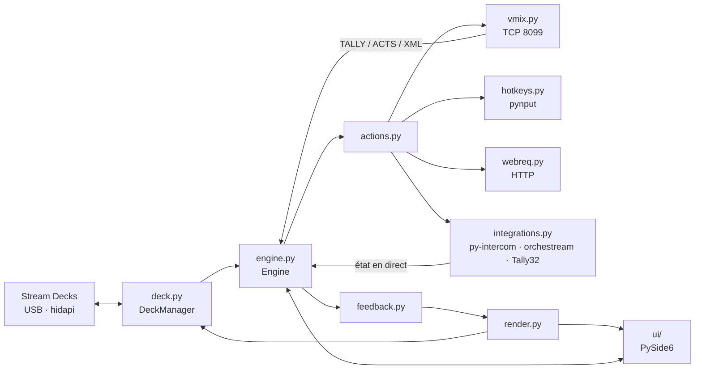

# 🧱 Architecture

← [Retour au README](../README.md)

## Vue d'ensemble

1. Un appui sur une touche physique arrive dans `DeckManager`, qui appelle `Engine.press(page, key, down)`.
2. Le moteur choisit les actions (appui, relâché, appui long, interrupteur) et les exécute dans **une file par
   touche** : les phases appui / relâché d'une même touche restent dans l'ordre, sans bloquer les autres touches.
3. Les actions parlent à vMix, au clavier, au réseau ou aux intégrations.
4. L'état revient par vMix (abonnement `TALLY` / `ACTS` + XML lu toutes les 300 ms) et par les intégrations
   (sondage de py-intercom et des tallys, flux SSE d'orchestream).
5. `feedback.py` déduit l'apparence de chaque touche ; `render.py` dessine la **même image** pour l'écran et
   pour le deck. Seules les touches dont l'image a changé sont renvoyées au Stream Deck.

## Modules

| Fichier | Rôle |
|---|---|
| `engine.py` | Cœur : configuration, annuler / rétablir, sauvegarde différée, exécution des touches, état en direct |
| `model.py` | Format de la configuration, valeurs par défaut, migration des anciennes versions, dossier `%APPDATA%\LiveDeck` |
| `vmix.py` | Client TCP vMix : commandes, abonnements, lecture du XML, résolution des inputs (numéro, GUID, titre, titre approché), latence |
| `deck.py` | Stream Decks : détection à chaud, pages par numéro de série, rendu en cache, appuis, identification, diagnostic |
| `actions.py` | Catalogue des actions : catégories, champs de l'inspecteur, exécution, résumé |
| `feedback.py` | Conditions de retour d'état et retours automatiques déduits des actions |
| `integrations.py` | py-intercom, orchestream (flux SSE), Tally32, et conversion des bricolages Companion |
| `presets.py` | Boutons prêts à l'emploi (tuiles de l'inspecteur, bibliothèque) |
| `render.py` | Dessin des touches (Pillow) : texte ajusté sans couper les mots, liseré, jauge d'appui long |
| `hotkeys.py` | Raccourcis clavier (pynput) : appui, relâché, tapé |
| `webreq.py` | Requêtes HTTP et lecture des commandes `curl` |
| `health.py` | Surveillance ping / HTTP |
| `companion_import.py` | Import `.companionconfig` : pages, decks, actions, retours |
| `autostart.py` | Lancement à l'ouverture de session (clé `Run` de l'utilisateur) |
| `app.py` | Démarrage : journal, instance unique, icône près de l'horloge, `--tray`, `--selftest` |
| `ui/` | Fenêtre principale, deck à l'écran, inspecteur, bibliothèque, réglages, recherche, diagnostic |

## Fils d'exécution

| Fil | Rôle |
|---|---|
| Qt (principal) | Interface ; les événements du moteur y arrivent par des signaux Qt |
| vMix | Lecture TCP en continu + interrogation du XML |
| Stream Decks | Détection à chaud toutes les 2 s, rappels d'appui de la bibliothèque Stream Deck |
| Une file par touche | Exécution ordonnée des actions (`ThreadPoolExecutor(1)`) |
| Intégrations | Un fil par service, actif seulement si une touche l'utilise |

## Tests

`tests/test_core.py` lance de vrais scénarios de bout en bout : faux vMix (`tools/fake_vmix.py`), faux Stream Deck,
faux py-intercom, orchestream et Tally32 (`tests/fakes.py`), interface Qt hors écran. Rien ne sort de `127.0.0.1`.
