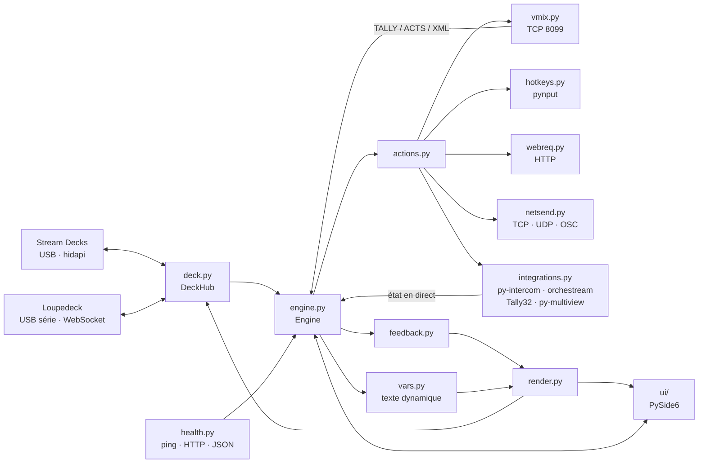

# 🧱 Architecture

← [Retour au README](../README.md)

## Vue d'ensemble



1. Un appui sur une touche physique arrive dans `DeckManager`, qui appelle `Engine.press(page, key, down, deck=…)`.
2. Le moteur choisit les actions (appui, relâché, appui long, interrupteur) et les exécute dans **une file par
   touche** : les phases appui / relâché d'une même touche restent dans l'ordre, sans bloquer les autres touches.
3. Les actions parlent à vMix, au clavier, au réseau ou aux intégrations.
4. L'état revient par vMix (abonnement `TALLY` / `ACTS` + XML lu toutes les 300 ms, et juste après chaque réponse
   `FUNCTION`), par les intégrations (sondage de py-intercom et des tallys, canal Transmit d'orchestream-v2 ou flux SSE de la v1) et par
   `health.py` (pings, HTTP, API JSON).
5. `feedback.py` déduit l'apparence de chaque touche, `vars.py` remplace les variables du texte ; `render.py`
   dessine la **même image** pour l'écran et pour le deck. Seules les touches dont l'image a changé sont renvoyées
   au Stream Deck.

## Modules

| Fichier | Rôle |
|---|---|
| `engine.py` | Cœur : configuration (verrou, annuler / rétablir, sauvegarde différée), exécution des touches, maintien et relâché, état en direct |
| `model.py` | Format de la configuration, valeurs par défaut, migrations (version 4), modèles de surfaces, contrôles hors grille (`page["controls"]`, case `c:<id>`), écriture atomique, sauvegardes, dossier `%APPDATA%\LiveDeck` |
| `vmix.py` | Client TCP vMix : commandes, abonnements, lecture du XML (inputs, textes, durées, transitions), état optimiste (`expect`), détection d'un vMix figé, latence |
| `deck.py` | Stream Decks : détection à chaud, pages par numéro de série, rendu en cache, appuis, identification, diagnostic. `DeckHub` fait cohabiter les familles de surfaces derrière une seule API |
| `loupedeck.py` | Pilote Loupedeck / Razer : découverte du port série, poignée de main « WebSocket », trames, écrans (RGB565), diodes RGB, vibration, décodage des molettes, du tactile et des boutons |
| `ldeck.py` | Loupedeck : même rôle que `deck.py`, plus les contrôles hors grille (molettes, bandeaux, boutons physiques) |
| `adjust.py` | Réglages au cran (volumes vMix, lecture, preview, son Windows) avec valeur optimiste, pour ne perdre aucun cran |
| `winsys.py` | Windows : son par Core Audio en ctypes (sortie, micro, applications), fenêtres, programmes, souris, verrouillage |
| `actions.py` | Catalogue des actions : catégories, champs de l'inspecteur, exécution, résumé, prochain appui, conversion en Take |
| `feedback.py` | Conditions de retour d'état et retours automatiques déduits des actions |
| `vars.py` | Texte dynamique : jetons `$(vmix:…)`, `$(time)`… remplacés en direct |
| `integrations.py` | py-intercom (messages d'erreur, bus découverts, renvoi du « off »), orchestream (v2 : état `/api/overlay/state` + canal Transmit `overlay` ; v1 : flux SSE, détectée automatiquement), Tally32, py-multiview (état complet sur `GET /status`, commandes `POST /<objet>/<verbe>`), tests de connexion, conversion des bricolages Companion |
| `netsend.py` | Trames TCP / UDP brutes et encodeur OSC maison (sans dépendance) |
| `presets.py` | Boutons prêts à l'emploi : catalogue de la touche vide, bibliothèque, intégrations à régler |
| `render.py` | Dessin des touches (Pillow) : texte ajusté sans couper les mots, liseré, jauge d'appui long |
| `hotkeys.py` | Raccourcis clavier (pynput) : appui, relâché, tapé |
| `webreq.py` | Requêtes HTTP, lecture des commandes `curl`, contournement du proxy pour les adresses locales, nature des erreurs réseau |
| `health.py` | Surveillance ping / HTTP et lecture d'API JSON (`JsonPoller`, chemin, comparaison) |
| `companion_import.py` | Import `.companionconfig` : pages, decks, actions, retours, variables, options (2e appui, intégrations) |
| `autostart.py` | Lancement à l'ouverture de session (clé `Run` de l'utilisateur, seulement depuis l'exe) |
| `app.py` | Démarrage : journal tournant, erreurs non gérées écrites dans le journal, instance unique, icône près de l'horloge, `--tray`, `--selftest` |
| `ui/` | Fenêtre principale (colonnes redimensionnables, pastilles, Moniteur), deck à l'écran, inspecteur, bibliothèque, réglages, recherche, diagnostic, petites fenêtres (`dialogs.py`) |

## Fils d'exécution

| Fil | Rôle |
|---|---|
| Qt (principal) | Interface ; les événements du moteur y arrivent par des signaux Qt |
| `vmix` | Lecture TCP en continu + interrogation du XML ; reconnexion si aucun XML complet depuis 3,5 s |
| `decks` | Détection à chaud toutes les 2 s, rappels d'appui de la bibliothèque Stream Deck |
| `btn` (un par touche) | File d'exécution ordonnée des actions (`_Runner`, fil démon : un appel bloqué n'empêche pas de quitter) |
| `long-press`, `release` | Surveillance d'un appui long ou d'une sécurité ; relâché différé |
| `vars` | Relit toutes les 0,5 s les textes qui contiennent des variables, et ne redessine que ceux qui changent |
| `health`, `json` | Pings / HTTP et API JSON des retours d'état |
| Intégrations | Un fil par service, actif si une touche l'utilise, si la fenêtre Réglages est ouverte, ou tant qu'un « off » py-intercom attend confirmation |

Tous les fils sont démons et protégés : une exception est écrite dans le journal sans arrêter le fil.

## Règles de sécurité du direct

- **Relâché sur une copie** : à l'appui, le moteur garde une copie de la touche, repérée par la touche physique
  (`(numéro de série, touche)`). Le relâché s'exécute sur cette copie : changer de page, modifier ou effacer la
  touche pendant le maintien envoie quand même le « off » au bon bus et relâche les bonnes touches du clavier.
- **`Engine.release_all()`** relâche les touches maintenues (toutes, ou celles d'un deck) et les interrupteurs
  verrouillés. Sans deck précis (arrêt, diagnostic), il coupe ensuite tous les bus py-intercom si l'un d'eux était
  maintenu ; pour un seul deck débranché, seul le « off » des bus relâchés part (les autres decks gardent leur
  talkback). Il est appelé au débranchement d'un deck, à l'entrée du diagnostic et à l'arrêt (`stop()`, attente
  bornée à ~2,5 s). `changed()` relâche aussi un interrupteur verrouillé dont la touche a disparu, n'est plus un
  interrupteur ou a d'autres actions maintenues.
- **« off » py-intercom confirmé** : un « off » est réessayé 3 fois ; s'il échoue, le bus est surveillé (jusqu'à
  ~60 s si le client revient). La 1re lecture de `/status` après le « off » décide : bus encore ouvert, « off »
  renvoyé (2 fois au plus, une seule alerte) ; bus fermé, ou en mode bascule dans le client (l'opérateur a pu le
  rouvrir), surveillance terminée. Un nouvel appui annule ce renvoi. Un bus « Toujours actif » n'est jamais coupé.
  Raccourci de secours utilisé après un « on » resté sans réponse : le relâché envoie quand même « off ».
- **Configuration** : toute modification passe par `Engine.mutate()` (verrou, annuler / rétablir). La sauvegarde
  prend un instantané sous verrou et l'écrit de façon atomique (`config.json.tmp`, `fsync`, `os.replace`) ; une
  copie par jour et avant chaque import dans `backups/`. Les clés commençant par `_` ne sont jamais enregistrées.
  Un `config.json` verrouillé (erreur d'E/S, pas de contenu) n'est jamais traité comme abîmé : `open_config`
  réessaie, puis `Engine.save_blocked` empêche toute écriture pour la session.
- **État optimiste** : après une commande preview / antenne, `VmixClient.expect()` met l'état à jour sans attendre
  le XML (1 s, ou la durée de la transition), pour qu'un double appui rapide fasse bien preview puis antenne.

## Tests

`tests/test_core.py` lance de vrais scénarios de bout en bout : faux vMix (`tools/fake_vmix.py`, Mix 1 à 4, titres,
vidéos, vMix lent ou figé), faux Stream Deck, faux Loupedeck (port série simulé : poignée de main, trames, molettes,
tactile), faux py-intercom, orchestream (v2 et v1), Tally32, py-multiview, API JSON et faux clavier
(`tests/fakes.py`), interface Qt hors écran. Rien ne sort de `127.0.0.1`, aucune vraie touche n'est simulée et le
registre Windows n'est jamais touché.

```bash
python tests/test_core.py        # ou : python -m pytest tests
python tools/fake_vmix.py 8099 0.08   # faux vMix sur le port 8099, avec 80 ms de délai de réponse
```
