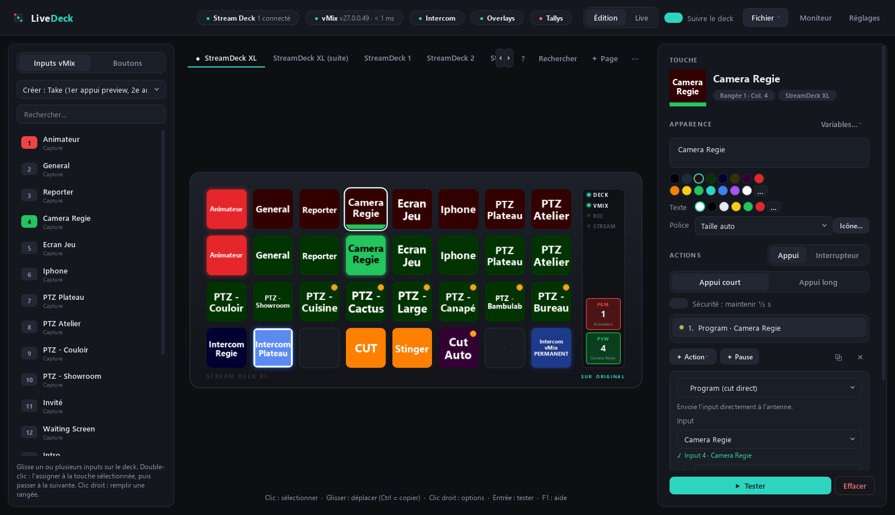
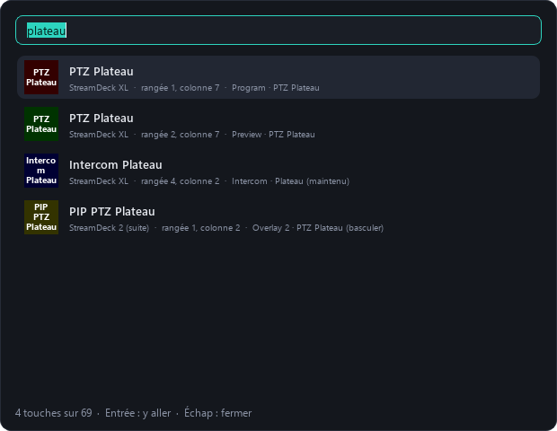
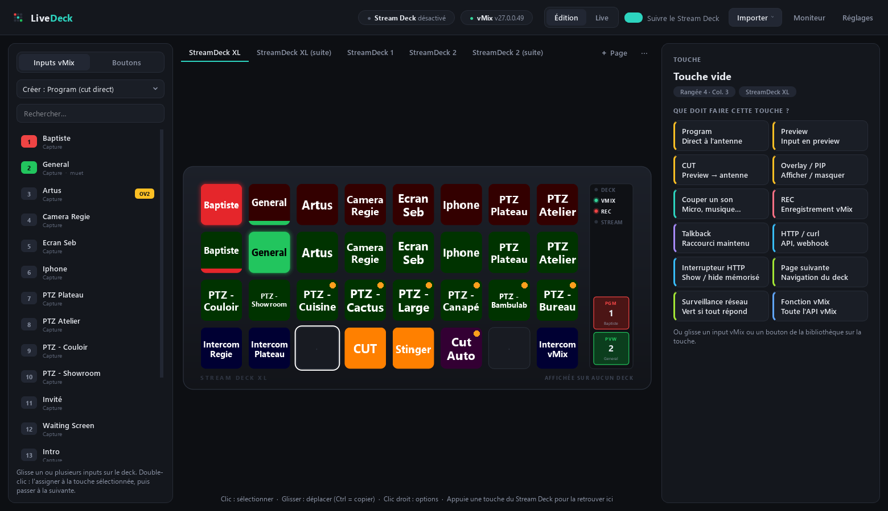
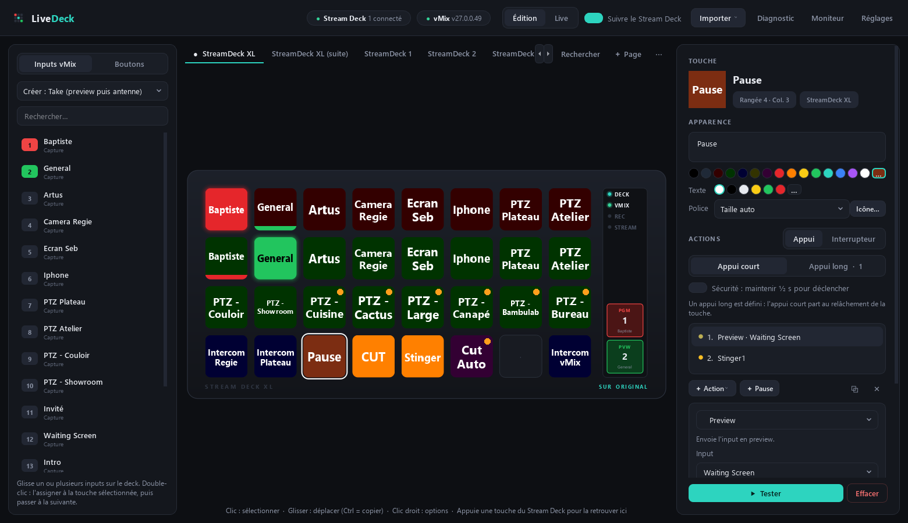
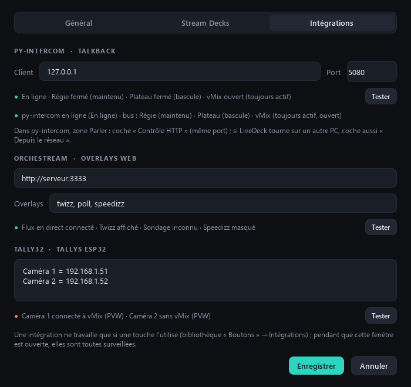
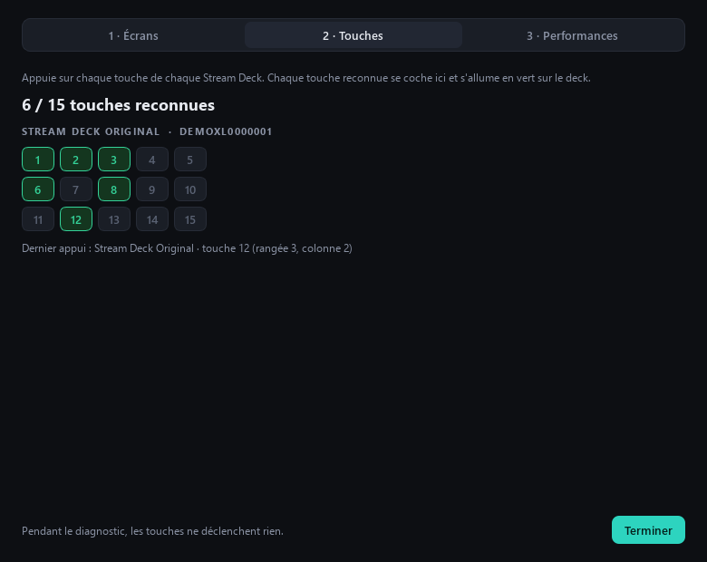

# 📘 Guide d'utilisation

← [Retour au README](../README.md)

## Sommaire

- [Premier lancement](#premier-lancement)
- [L'interface](#linterface)
- [Créer des touches vite](#créer-des-touches-vite)
- [Les étapes d'une touche](#les-étapes-dune-touche)
- [Take : preview puis antenne](#take--preview-puis-antenne)
- [Texte dynamique](#texte-dynamique)
- [Retours d'état automatiques](#retours-détat-automatiques)
- [Ce qui change par rapport à Companion](#ce-qui-change-par-rapport-à-companion)
- [Raccourcis](#raccourcis)
- [Intégrations maison](#intégrations-maison)
- [Commandes réseau : OSC, TCP / UDP, API JSON](#commandes-réseau--osc-tcp--udp-api-json)
- [Diagnostic Stream Deck](#diagnostic-stream-deck)
- [Barre des tâches et démarrage automatique](#barre-des-tâches-et-démarrage-automatique)
- [Sauvegardes](#sauvegardes)
- [Dépannage](#dépannage)

## Premier lancement

1. Ferme Bitfocus Companion et le logiciel Elgato Stream Deck : une seule application à la fois peut piloter un Stream Deck.
2. Lance LiveDeck, puis **Fichier → Config Bitfocus Companion…** pour reprendre ta configuration existante.
   Deux options te sont proposées avant l'import :
   - **2e appui sur une touche Preview** : laisse « Rien, comme dans Companion », ou choisis une transition pour
     qu'un 2e appui sur un input déjà en preview l'envoie à l'antenne ;
   - **Convertir vers les intégrations natives** : à cocher seulement si tu utilises py-intercom, orchestream ou
     Tally32 (voir [Intégrations maison](#intégrations-maison)). Avec **Ajouter les pages**, les réglages trouvés
     (adresse orchestream, overlays, tallys) complètent les tiens sans les remplacer.

   Chaque Stream Deck retrouve sa page grâce à son numéro de série.
3. Côté vMix, rien à configurer : LiveDeck utilise l'API TCP (port 8099), active par défaut.
   Si vMix tourne sur un autre PC, indique son adresse dans **Réglages**.

## L'interface

| Zone | Rôle |
|---|---|
| **En-tête** | Pastilles d'état : Stream Decks (clic = Diagnostic), vMix (version, latence ; clic = Réglages) et une pastille par intégration utilisée (clic = Réglages → Intégrations). Puis Édition / Live, *Suivre le deck*, **Fichier**, Moniteur, Réglages |
| **Gauche** | **Inputs vMix** en direct (pastille rouge = antenne, verte = preview, badge OV = en overlay) et **Boutons** prêts à l'emploi, avec recherche |
| **Centre** | Le Stream Deck à l'écran, avec sa colonne d'état (deck, vMix, REC, STREAM, PGM, PVW). Un onglet par page ; ● = page affichée sur un deck branché |
| **Droite** | L'inspecteur de la touche : apparence, étapes, retour d'état, **▶ Tester** |

- Les colonnes de gauche et de droite se **redimensionnent** en tirant leur bord ; LiveDeck retient leur largeur.
  Sur un petit écran, l'inspecteur passe les libellés au-dessus des champs au lieu de défiler sur le côté.
- **Suivre le deck** : appuyer sur une touche physique la sélectionne dans l'éditeur (et change de page si besoin).
  Chaque appui fait flasher la touche à l'écran.
- **Survoler une touche** du deck à l'écran affiche ce qu'elle fait, son prochain appui et ses problèmes éventuels
  (input introuvable, py-intercom indisponible).
- **Édition / Live (F5)** : en Live, un clic déclenche la touche comme sur le deck.
- **Verrouiller (Ctrl+L)** : pour un direct, bloque l'édition (bibliothèque, éditeur, pages, import, réglages) et les
  clics sur les touches de l'écran : plus de fausse manip à la souris. Les Stream Decks physiques continuent de
  fonctionner. Le verrou est immédiat, déverrouiller demande une confirmation, et il est conservé si LiveDeck est
  relancé. Disponible aussi dans le menu de l'icône près de l'horloge.
- **Moniteur** : journal horodaté des actions envoyées, des alertes et des erreurs (commande refusée par vMix,
  HTTP en échec, py-intercom injoignable…). Le bouton affiche le nombre d'erreurs et d'alertes non lues ; un filtre
  montre *Erreurs et alertes* ou *Actions envoyées*, avec **Copier**, **Effacer** et **Fichier journal**.
  Les erreurs et alertes s'affichent aussi en bandeau en bas de la fenêtre : clique dessus pour ouvrir le Moniteur.
- **Fichier** : importer (Companion, configuration LiveDeck, une page), exporter (la configuration, la page
  affichée), Diagnostic Stream Deck, raccourcis et légende (**F1**), dossier des données.
- **Rechercher (Ctrl+F)** : retrouve une touche sur toutes les pages par son texte, son input, son action ou sa page.

En mode **Live**, l'édition est verrouillée (inspecteur, collage, suppression, dépôts) : la colonne de droite montre
la touche en lecture seule (ce qu'elle fait, son prochain appui, les inputs manquants, l'état des intégrations) et
seul **▶ Tester** reste actif. De quoi laisser l'écran ouvert pendant le direct sans risque.

## Créer des touches vite

- **Touche vide** : l'inspecteur propose tout ce qu'une touche peut faire, rangé par famille (Vidéo, Production,
  Audio, Intégrations, Clavier, Web, Réseau, Deck…), avec un champ de recherche et des puces de catégorie.
  Une intégration pas encore réglée est marquée « à configurer » : la touche se crée quand même, et son
  inspecteur te mène aux **Réglages…**. Take, Program, Preview, Overlay et Son ouvrent directement la liste des
  inputs.
- **Une rangée en quelques secondes** : sélectionne la première touche, puis double-clique les inputs
  un par un dans la colonne de gauche. Chaque double-clic assigne l'input et passe à la touche suivante.
- **Remplir la rangée…** (clic droit sur une touche, ou sur la liste des inputs) : choisis un style (Take,
  Preview + Program, Preview, Program, Overlay 1-4, Couper le son) et les inputs à placer, la rangée est remplie à
  partir de la touche choisie. Une seule étape d'annulation.
- **Glisser-déposer** : glisse un ou plusieurs inputs sur le deck. Le menu « Créer » choisit le type
  (Take, Program, Preview, Preview + Program sur 2 rangées, Overlay 1-4, Couper le son).
- **Bibliothèque « Boutons »** : CUT, Fade, Stinger, FTB, REC, STREAM, MultiCorder, talkback py-intercom, overlays
  orchestream, raccourci maintenu, HTTP, OSC, TCP, interrupteur, liens directs vers chaque page… à glisser sur une
  touche ou à double-cliquer. Les bus py-intercom et les overlays orchestream découverts en direct y apparaissent.
- **Double-clic sur une touche existante** : un input double-cliqué remplace son input, et son texte suit.
- **Convertir en Take** : clic droit sur une touche Preview ou Program, sur sa rangée, ou menu de l'onglet pour
  toute la page.
- **Partager une page** : clic droit sur l'onglet → **Exporter la page…** / **Importer une page…** (fichier `.json`).
  Une page importée s'ajoute aux tiennes sans rien écraser.

## Les étapes d'une touche

Une touche enchaîne une ou plusieurs étapes (ex. *Preview · Waiting Screen* puis *Stinger1*). On
sélectionne une étape dans la liste pour la modifier ; glisser pour réordonner, **＋ Action** pour en ajouter
(dont **Pause** dans *Avancé*). Changer le type d'une étape garde ses réglages compatibles (input, mix…).

Sous le titre de la touche, **Prochain appui** dit en clair ce que fera le prochain appui
(« mettre en preview », « À L'ANTENNE (Fade) », « rien : l'input est déjà à l'antenne »…), en suivant l'état de vMix en direct.

En mode **Interrupteur**, deux listes : *À l'activation* et *À la désactivation*. L'état est mémorisé
et affiché sur la touche.

### Appui court / appui long

En mode Appui, une touche peut avoir une deuxième série d'actions sur **appui long** (½ s), par exemple
« preview » en appui court et « direct à l'antenne » en appui long. Une jauge se remplit en haut de la
touche pendant qu'on la maintient. Dès qu'un appui long est défini, l'appui court part au relâchement.

La case **Sécurité** impose de maintenir la touche ½ s pour la déclencher : idéal pour FTB ou l'arrêt du
stream (la bibliothèque propose *FTB sécurisé* et *Arrêt du stream*). Elle vaut aussi pour un **Interrupteur** :
un appui bref ne le fait pas basculer.

### Actions maintenues (talkback, raccourci maintenu)

Un talkback py-intercom en mode *Maintenu* ou un raccourci clavier *Maintenir* reste actif tant que tu gardes le
doigt sur la touche, quel que soit le type de touche :

| Touche | Le maintien commence… | … et s'arrête |
|---|---|---|
| Normale ou avec appui long | à l'appui | au relâché |
| Avec **Sécurité** | une fois la ½ s atteinte | au relâché |
| **Interrupteur** | au 1er appui (après la ½ s s'il est sécurisé) | au 2e appui |

Le relâché part toujours vers ce qui a été ouvert à l'appui, même si tu changes de page, modifies ou effaces la
touche pendant ce temps. Un interrupteur verrouillé est relâché dès que tu effaces la touche, la passes en
*Appui*, changes ses actions maintenues ou annules. Débrancher un Stream Deck relâche ce que ce deck tenait
(les autres decks gardent leur talkback) ; quitter LiveDeck relâche tout (raccourcis, interrupteurs, micros
py-intercom).

## Take : preview puis antenne

L'action **Take** remplace la paire Preview + Program : une seule touche par input.

| Tu appuies quand la touche est… | Ce qui se passe |
|---|---|
| **sans couleur** (input ni en preview ni à l'antenne) | l'input passe en **preview** : la touche devient **verte** |
| **verte** (en preview, prêt à prendre) | la transition choisie (Cut, Fade, Stinger…) l'envoie **à l'antenne** : la touche devient **rouge** |
| **rouge** (déjà à l'antenne) | rien, pour ne pas couper l'image par erreur |

Un **liseré vert sous une touche rouge** veut dire que l'input est à l'antenne et aussi en preview. Le rouge
l'emporte toujours sur le vert. Deux appuis rapprochés marchent : LiveDeck tient compte de sa propre commande sans
attendre que vMix réponde. Le Mix (1 à 16) se choisit dans l'étape.

**Une touche Preview peut faire pareil** : dans l'étape *Preview*, l'option **2e appui (déjà en preview)** envoie
l'input à l'antenne avec la transition choisie si tu appuies alors qu'il est déjà en preview. Par défaut elle
reste sur « Rien », comme dans Companion. Pour passer d'un coup à Take, utilise **Convertir en Take**.

La liste des transitions reprend celle de vMix : effets (et leurs versions inversées), **Stinger 1-4** et
**Bouton transition 1-4** (la transition réglée sur ce bouton dans vMix). La durée à 0 garde celle de vMix.

## Texte dynamique

Le texte d'une touche peut contenir des **variables** remplacées en direct. Le menu **Variables…** à côté de
*Apparence* les insère pour toi. Exemple : `CLIP\n$(vmix:remaining:Magneto)` affiche le temps restant d'une vidéo.

| Variable | Affiche |
|---|---|
| `$(vmix:program_title)` / `$(vmix:preview_title)` | Titre de l'input à l'antenne / en preview (`:2` pour le Mix 2) |
| `$(vmix:program_number)` / `$(vmix:preview_number)` | Son numéro |
| `$(vmix:input_title:<input>)` / `$(vmix:input_number:<input>)` | Titre / numéro d'un input |
| `$(vmix:input_state:<input>)` | État de lecture (Running, Paused…) |
| `$(vmix:remaining:<input>)` | Temps restant d'une vidéo ou d'un son (m:ss) |
| `$(vmix:position:<input>)` / `$(vmix:duration:<input>)` | Position de lecture / durée totale |
| `$(vmix:volume:<input>)` | Volume (0-100) |
| `$(vmix:text:<input>:<champ>)` | Texte d'un titre : `Headline.Text`, `Headline` ou l'index `0` |
| `$(vmix:recording_duration)` / `$(vmix:streaming_duration)` | Durée de l'enregistrement / du stream |
| `$(time)` · `$(time:hm)` · `$(date)` | Heure (hh:mm:ss, hh:mm) et date |

`<input>` se désigne comme partout : numéro, titre ou GUID. Une valeur indisponible (vMix hors ligne, input
introuvable) affiche « — ». Seules les touches dont le texte change sont redessinées. À l'import Companion, les
variables courantes (`$(vmix:input_X_name)`, `$(vmix:input_X_remaining)`, `$(internal:time_hms)`…) sont converties.

## Retours d'état automatiques

Rien à configurer : la touche s'allume selon ce qu'elle fait.

| Touche | Retour |
|---|---|
| Take / Preview | fond vert en preview, **rouge à l'antenne** (liseré vert si aussi en preview) |
| Program | fond rouge à l'antenne, liseré vert en preview |
| Preview + transition (ex. Waiting Screen + Stinger) | traitée comme une touche Program |
| Overlay / PIP | fond jaune quand l'input est sur l'overlay, liseré vert en preview |
| Couper un son | fond rouge quand l'input est coupé, liseré vert quand il est actif |
| Rec / Stream / FTB / MultiCorder | rouge quand actif |
| Talkback py-intercom | bleu micro ouvert ; grisée avec HORS LIGNE, DÉSARMÉ ou BUS ABSENT ; bleu foncé PERMANENT pour un bus « Toujours actif » |
| Raccourci maintenu | bleu tant que la touche est enfoncée |
| Interrupteur | jaune quand il est actif |

**＋ Personnaliser** ajoute ses propres conditions : n'importe quel input, Mix 2 à 16, overlay, son,
état vMix, interrupteur, touche enfoncée, équipements réseau (ping ou HTTP), valeur d'une API JSON.

Un **point orange** sur une touche signale un input introuvable dans vMix. À la connexion, les noms
approchés importés de Companion (`cameraregie`) sont remplacés par le titre exact (« Camera Regie »).
La légende complète des couleurs est dans **F1**.

## Ce qui change par rapport à Companion

| Dans Companion | Dans LiveDeck |
|---|---|
| Action + feedback + couleurs à régler séparément | Le retour d'état est déduit de l'action |
| Variables `$(vmix:input_xxx_number)` | L'input se choisit par son nom dans la liste en direct |
| 2 touches Preview + Program par input | Une touche **Take** |
| VICREO Listener + press/release Shift puis A | Un raccourci `shift+a` avec **Maintenir**, enregistré en appuyant sur les touches |
| Variable custom + `logic_if` + 2 « set value » | Mode **Interrupteur** |
| generic-http rempli champ par champ | **Coller une commande curl…** |
| Modules OSC / TCP / UDP génériques | Actions **Message OSC** et **Commande TCP / UDP** |
| 6 pings + 3 GET + 5 variables d'expression | Retour **Équipements réseau** : vert si tout répond, rouge avec la liste des absents |

## Raccourcis

| Touche | Effet |
|---|---|
| Flèches | Déplacer la sélection |
| Entrée | Tester la touche sélectionnée |
| F2 | Modifier le texte de la touche |
| Ctrl+C / Ctrl+X / Ctrl+V / Ctrl+D | Copier / couper / coller / dupliquer la touche |
| Suppr | Effacer la touche |
| Ctrl+Z / Ctrl+Y | Annuler / rétablir (toutes les modifications, réglages compris) |
| Ctrl+F | Rechercher une touche |
| Ctrl+Pg↑ / Ctrl+Pg↓ | Page précédente / suivante |
| F5 | Basculer Édition / Live |
| F1 | Raccourcis et légende des couleurs |
| Échap | Désélectionner |

Clic droit sur une touche : tester, copier, **convertir en Take**, **remplir la rangée**, **envoyer vers une autre
page**, effacer. Clic droit sur un onglet : renommer, taille de grille, dupliquer, convertir en Take, exporter /
importer la page, supprimer la page.

Dans **Réglages**, chaque Stream Deck (identifié par son numéro de série) est associé à sa page ;
le bouton **Identifier** l'allume en couleur pour savoir lequel est lequel. Modèles reconnus : Mini, Neo,
Original / MK.2, +, + XL, XL, Studio et Pedal (les touches tactiles du Neo changent de page).

La configuration est enregistrée automatiquement dans `%APPDATA%\LiveDeck\config.json`, indépendamment
de l'installation : mettre à jour ou désinstaller LiveDeck ne la touche pas
(**Fichier → Exporter → La configuration…** pour une copie).

## Intégrations maison

Réglages → **Intégrations**, et les boutons prêts dans la bibliothèque (catégorie *Intégrations*).
Chaque intégration ne travaille que si une touche l'utilise ; pendant que la fenêtre Réglages est ouverte,
elles sont toutes surveillées.

| Outil | Ce que fait LiveDeck | Retour sur la touche |
|---|---|---|
| **py-intercom** (API du client, `http://127.0.0.1:5080`) | Talkback maintenu (`on` à l'appui, `off` au relâché), basculer, ouvrir, fermer, couper tous les bus | Bleu micro ouvert ; HORS LIGNE, DÉSARMÉ, BUS ABSENT ou PERMANENT sinon |
| **orchestream** (overlays web) | Afficher / masquer / basculer, avec l'état suivi en direct (canal `overlay` d'orchestream-v2, ou flux `/api/overlay/events` de la v1) | Jaune quand l'overlay est affiché, liseré gris si l'état est inconnu |
| **Tally32** (`GET /status`, `POST /vmix/reconnect`) | Reconnecter un tally ou tous à vMix, surveillance toutes les 3 s | Vert si tous sont connectés à vMix, rouge avec le nom des tallys en défaut |
| **py-multiview** (multiviewer SRT/OMT, `GET /status`) | Démarrer / arrêter un flux, toute la réception, l'émission OMT, le retour audio ou la fenêtre de retour ; couper le son d'un flux ; régler le volume du retour | Vert quand c'est en marche, brun en défaut (attente, relance), liseré gris et HORS LIGNE si py-multiview ne répond pas |

### Régler py-intercom

1. Il faut le **client py-intercom compilé le 29/10/2026 ou plus récent** (version 2.0.x).
2. Dans le client, zone **Parler** : coche **« Contrôle HTTP »** (port 5080 par défaut).
   Si LiveDeck tourne sur un autre PC que le client, coche aussi **« Depuis le réseau »** et indique l'IP du PC
   intercom dans LiveDeck.
3. Dans LiveDeck, Réglages → Intégrations : adresse et port du client, puis **Tester**. Le résultat dit en clair ce
   qui ne va pas : client fermé ou « Contrôle HTTP » non coché, mauvaise IP ou pare-feu, proxy, client désarmé
   (pas connecté au serveur intercom), bus absent…

La liste des **bus** vient du client lui-même : choisis-le dans l'étape *Intercom*. Sur la touche :

| Libellé | Signification |
|---|---|
| HORS LIGNE | le client ne répond pas (fermé, « Contrôle HTTP » non coché, réseau) |
| DÉSARMÉ | le client répond mais n'est pas connecté au serveur intercom |
| BUS ABSENT | ce bus n'est pas proposé par le client |
| PERMANENT | le bus est en « Toujours actif » dans le client : LiveDeck ne le coupe jamais au relâché |

L'inspecteur d'une touche Intercom affiche le même statut, avec **Tester la connexion** et **Réglages…**.

**Raccourci de secours** : dans l'étape *Intercom*, tu peux indiquer un raccourci clavier (par ex. celui de ton
ancien talkback). Si py-intercom ne répond pas, LiveDeck le simule à la place : maintenu tant que tu tiens la
touche en mode *Maintenu*, tapé en mode *Basculer*. Il n'est jamais utilisé quand le client est simplement désarmé
ou que le bus manque. Si le client était seulement lent, il a pu ouvrir le micro en retard : au relâché, LiveDeck
lui envoie donc aussi « off ». À la conversion d'une config Companion, l'ancien raccourci est gardé ici.

Les adresses locales (127.0.0.1, réseau privé, noms en `.local`) ne passent jamais par le proxy de Windows :
un proxy d'entreprise ne peut plus bloquer le talkback.

### orchestream et Tally32

- **orchestream** : indique l'adresse **locale** du serveur (par ex. `http://192.168.1.20:5174` pour
  orchestream-v2) et la liste des overlays (`twizz, poll = Sondage, speedizz` : `nom = Libellé` pour un nom
  affiché). Les overlays connus du serveur sont aussi proposés automatiquement. LiveDeck reconnaît tout seul
  orchestream-v2 et l'ancienne version (v1).
  - Avec **orchestream-v2**, l'état des overlays est lu dès la connexion : une touche est jaune tout de suite si
    l'overlay est déjà à l'antenne. Montrer un widget vide (pas de question, pas de sondage) est refusé, et le
    Moniteur affiche le message d'orchestream (« Aucun Twizz à afficher : lancez une partie d'abord. »).
  - orchestream-v2 n'accepte la régie que par son adresse locale. Son adresse publique (tunnel, passerelle
    invités) répond « introuvable » : **Tester** te le dit et te propose l'adresse locale.
- **Tally32** : un tally par ligne, `Nom = IP`. Si un tally répond sans connaître `/vmix/reconnect`, le Moniteur
  te demande de mettre à jour son firmware.

### Régler py-multiview

Indique l'adresse du poste py-multiview : `192.168.1.42` suffit, le port `5090` est ajouté tout seul.

Côté py-multiview, il faut ouvrir l'API : **Préférences → Pilotage à distance → Ouvrir l'API locale**, en
décochant *Ce poste uniquement* pour y accéder depuis cette machine.

Une touche choisit sa **cible** — un flux, toute la réception, l'émission OMT, le retour audio, la fenêtre de
retour, le son d'un flux ou une route multicast — et son **mode** : *Démarrer*, *Arrêter* ou *Basculer*.
« Basculer » est résolu à partir de l'état lu, donc deux appuis rapides ne se croisent pas.

Un flux se désigne par son **nom** ou par son **numéro** (`1`, `2`…) : la liste est proposée dès que LiveDeck
a vu py-multiview au moins une fois, et reste saisissable à la main sinon. Nommer le flux plutôt que le
numéroter garde la touche juste même si l'ordre change.

### Conversion depuis Companion

À l'import Companion, coche **Convertir vers les intégrations natives** pour convertir :
les touches *Intercom* (raccourcis Shift+A/Z/E via VICREO) vers l'API py-intercom (le raccourci est gardé en
secours), les interrupteurs show/hide d'orchestream vers l'overlay suivi en direct, et le bouton *Check Tally*
(pings + GET + variables) vers la surveillance native des Tally32. Une configuration LiveDeck 1.x est convertie
à l'ouverture ; les touches converties sont listées une fois dans le Moniteur.

Limite de l'ancienne version (orchestream v1) : elle ne mémorise pas l'état de Twizz et du Sondage. Au
démarrage, LiveDeck l'ignore (liseré gris) jusqu'au premier changement ; orchestream-v2 n'a plus cette limite.

## Commandes réseau : OSC, TCP / UDP, API JSON

Catégorie **Réseau** du menu ＋ Action, pour piloter d'autres logiciels et appareils sans module dédié.

| Action | Réglages | Exemple |
|---|---|---|
| **Message OSC** (UDP) | machine, port, adresse, arguments | QLab `127.0.0.1:53000`, adresse `/go` ; X32 `/ch/01/mix/on` avec `0` |
| **Commande TCP / UDP** | protocole, machine, port, données | projecteur `PWR ON\r` ; caméra VISCA en hexadécimal `81 01 04 00 02 FF` |

- **Arguments OSC**, séparés par des espaces : `1` (entier), `0.5` (réel), `true` / `false`, `"texte avec espaces"`.
  Un préfixe force le type : `i:` entier, `f:` réel, `s:` texte (`s:12` envoie le texte « 12 »).
- **Données TCP / UDP** : texte avec `\r`, `\n`, `\t`, `\0`, `\xNN`, ou coche **Données en hexadécimal**.
  LiveDeck envoie la trame sans attendre de réponse.

Le retour d'état **Valeur d'une API JSON** (＋ Personnaliser) lit une URL toutes les N secondes, va chercher une
valeur dans la réponse (`data.viewers`, `items[0].state`) et la compare (égal, différent, supérieur, inférieur,
contient, vrai, toujours, API en erreur). **Texte affiché** peut montrer la valeur lue : `Spectateurs\n{value}`.
Une valeur vrai / faux se compare avec `true`, `false`, `oui`, `non`, `1` ou `0`. L'URL est relue juste après un appui
sur la touche (réponse jusqu'à 4 Mo).

## Diagnostic Stream Deck

**Fichier → Diagnostic Stream Deck…**, ou clic sur la pastille des Stream Decks.

| Onglet | Ce qu'il vérifie |
|---|---|
| **1 · Écrans** | Numérote chaque touche, affiche rouge / vert / bleu / blanc, fait varier la luminosité |
| **2 · Touches** | Appuie sur chaque touche : elle se coche à l'écran et s'allume en vert sur le deck |
| **3 · Performances** | Latence vMix, temps de lecture de l'état, temps d'affichage d'une touche, avec des conseils |

Pendant le diagnostic, les touches ne déclenchent rien (les actions maintenues sont relâchées avant).
À la fermeture, chaque deck retrouve la page qu'il affichait.

## Barre des tâches et démarrage automatique

- Fermer la fenêtre la **réduit près de l'horloge** : les Stream Decks continuent de fonctionner. Clic
  droit sur l'icône pour afficher LiveDeck, passer en Live, lancer le diagnostic ou **Quitter**.
- **Réglages → Démarrage** : lancer LiveDeck à l'ouverture de session Windows (réduit près de l'horloge),
  démarrer directement en mode Live.
- Une seule instance à la fois : relancer LiveDeck ramène simplement la fenêtre au premier plan
  (deux instances se disputeraient les decks).

## Sauvegardes

- La configuration est écrite de façon sûre (fichier temporaire puis remplacement) : une coupure de courant ne
  la corrompt pas.
- Une copie est faite **chaque jour** et **avant chaque import** dans `%APPDATA%\LiveDeck\backups` (les 20 dernières
  sont gardées). **Fichier → Ouvrir le dossier des données** y mène directement.
- Si `config.json` est abîmé, LiveDeck le renomme `config.json.corrupt-<date>`, démarre avec une configuration
  vide et te le signale : recopie la dernière sauvegarde de `backups` à la place de `config.json` pour tout retrouver.
- Si `config.json` est seulement **verrouillé** (OneDrive, antivirus, éditeur ouvert), LiveDeck réessaie, puis
  démarre avec une configuration vide **sans jamais rien enregistrer**, pour ne pas écraser ton fichier : ferme ce
  qui le bloque et relance LiveDeck.

## Dépannage

| Symptôme | Piste |
|---|---|
| Aucun Stream Deck détecté | Companion ou le logiciel Elgato est encore ouvert : ferme-les, LiveDeck retrouve les decks tout seul (détection à chaud toutes les 2 s). |
| Point orange sur une touche | L'input n'existe pas (ou plus) dans vMix : choisis-le à nouveau dans l'inspecteur. |
| vMix « hors ligne » dans l'en-tête | Vérifie l'adresse dans **Réglages** et que l'API TCP de vMix (port 8099) n'est pas bloquée par le pare-feu. Un vMix figé est détecté après 3,5 s et LiveDeck se reconnecte seul. |
| Take : le 2e appui ne fait rien | La touche est rouge : l'input est déjà à l'antenne, Take ne le recoupe pas. Sur une touche **Preview**, le 2e appui ne fait rien par défaut : règle l'option *2e appui* ou convertis-la en Take. |
| **L'intercom ne marche pas** | Réglages → Intégrations → **Tester** : le message dit quoi faire. Le plus souvent : client py-intercom trop ancien (il faut celui du 29/10/2026 ou plus récent), « Contrôle HTTP » non coché dans la zone Parler, ou « Depuis le réseau » non coché si LiveDeck est sur un autre PC. |
| Touche talkback HORS LIGNE | Le client ne répond pas : lance-le, coche « Contrôle HTTP », vérifie l'IP et le port (5080). Un raccourci de secours peut prendre le relais. |
| Touche talkback DÉSARMÉ | Le client tourne mais n'est pas connecté au serveur intercom : connecte-le dans py-intercom. |
| Touche talkback BUS ABSENT | Ce bus n'existe pas dans le client : choisis-en un autre dans l'étape *Intercom* (la liste vient du client). |
| Talkback refusé « proxy » | Un proxy intercepte la requête : les adresses locales le contournent déjà ; pour une IP publique, vérifie `HTTP_PROXY` ou le proxy de Windows. |
| Overlay orchestream avec liseré gris | orchestream v1 : état inconnu tant que l'overlay n'a pas changé depuis le démarrage (passe à orchestream-v2). Sinon, LiveDeck n'est pas connecté : clique **Tester** dans Réglages → Intégrations. |
| Une variable affiche « — » | vMix est hors ligne ou l'input de la variable est introuvable. |
| Une action ne fait rien | Ouvre le **Moniteur** : chaque refus de vMix (avec la commande refusée), d'un serveur HTTP, de py-intercom, d'orchestream ou d'un tally y est écrit avec son message. |

Le journal complet est dans `%APPDATA%\LiveDeck\livedeck.log` (**Moniteur → Fichier journal**).
