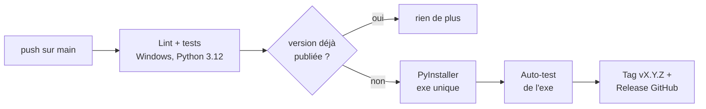

# 🚀 Publier une version

← [Retour au README](../README.md)

Une release = un **exe Windows** compilé automatiquement par GitHub Actions et publié dans
[Releases](https://github.com/lfpoulain/py-livedeck/releases).

## En résumé

1. Décris les changements dans **`CHANGELOG.md`** sous un nouveau titre `## 1.3.0 — AAAA-MM-JJ`, puis commite.
2. Lance :

   ```bash
   python tools/release.py 1.3.0
   ```

3. Quelques minutes plus tard, la release **LiveDeck 1.3.0** apparaît avec son exe `LiveDeck-1.3.0-win64.exe`
   et les notes tirées du CHANGELOG.

Tu peux aussi monter la version à la main dans `livedeck/__init__.py` et pousser sur `main` : le résultat est le même.

## Ce que fait `tools/release.py`

| Étape | Détail |
|---|---|
| Vérifications | Branche `main`, dépôt propre, version pas encore publiée, section `## 1.3.0` présente dans le CHANGELOG |
| Lint et tests | `pyflakes` et `tests/test_core.py` doivent passer, sinon rien n'est publié |
| Version | Met à jour `livedeck/__init__.py` et commite « Version 1.3.0 » |
| Push | Pousse `main` : GitHub Actions prend le relais |

Avec `--dry-run`, le script fait toutes les vérifications sans rien modifier.

## Ce que fait GitHub Actions

Le workflow [`ci.yml`](../.github/workflows/ci.yml) se déclenche à **chaque push sur `main`** :



- Un push qui ne change pas la version lance seulement le lint et les tests : pas de release en double.
- Avant d'être publié, l'exe est lancé en `--selftest` : il doit démarrer, embarquer le clavier (pynput) et
  la bibliothèque USB des Stream Decks (hidapi).
- L'exe est aussi conservé en **artefact** du workflow.
- Les pull requests lancent le lint et les tests, sans rien publier.

## Compiler l'exe sur ton PC

Double-clique sur **`build_exe.bat`**, ou :

```bash
pip install -r requirements-build.txt
```

```bash
python tools/build_exe.py
```

Le fichier arrive dans `dist/`. La compilation :

- génère l'icône (dessinée par l'app elle-même, en toutes tailles) ;
- renseigne les métadonnées Windows de l'exe (version, description), visibles dans les propriétés du fichier ;
- produit un **exe unique sans console**, avec Qt, la bibliothèque Stream Deck, `hidapi.dll` et pynput.

`hidapi.dll` n'est pas versionnée : `setup.bat` (ou `python -m livedeck.setup_hidapi`) la télécharge depuis
les releases officielles de [libusb/hidapi](https://github.com/libusb/hidapi).

## Données personnelles

L'app range sa configuration dans `%APPDATA%\LiveDeck` (variable `LIVEDECK_HOME` pour choisir un autre dossier),
que tu la lances en exe ou depuis les sources. Rien n'est écrit dans le dépôt, et les exports Companion
(`*.companionconfig`) sont exclus par `.gitignore` : ta config de régie reste sur ton PC.
Les tests utilisent une config de démonstration anonymisée (`tests/fixtures/demo.companionconfig`) et des serveurs
simulés (vMix, py-intercom, orchestream, Tally32) sur `127.0.0.1`.
